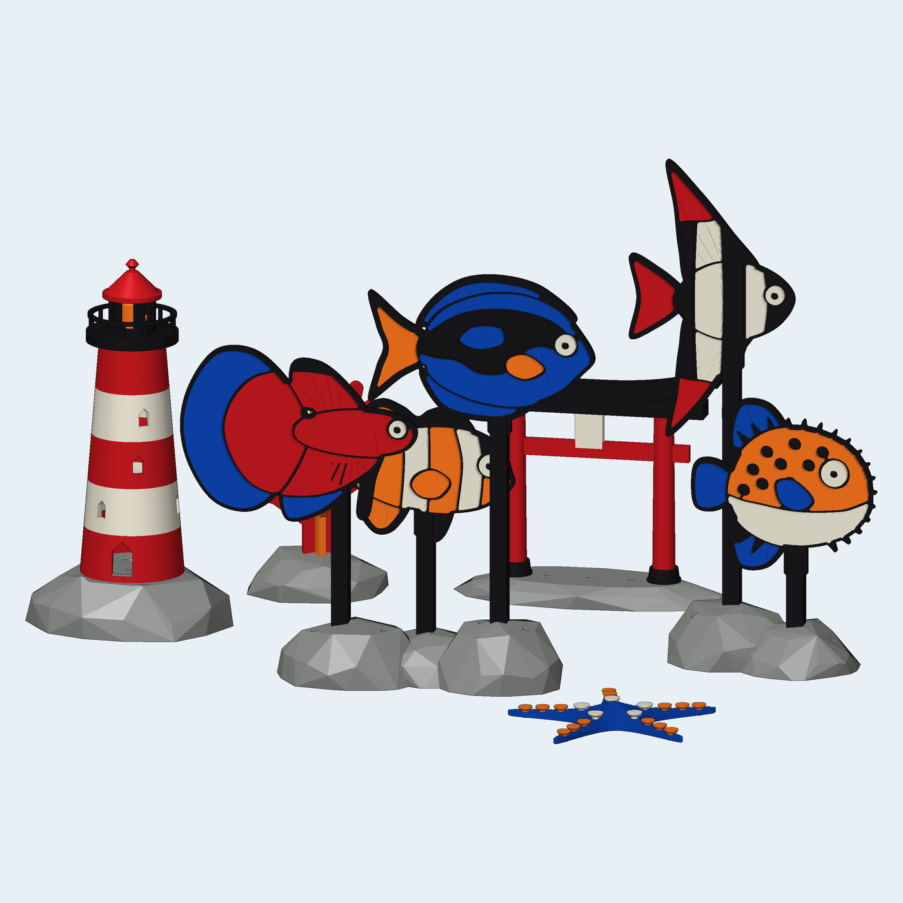
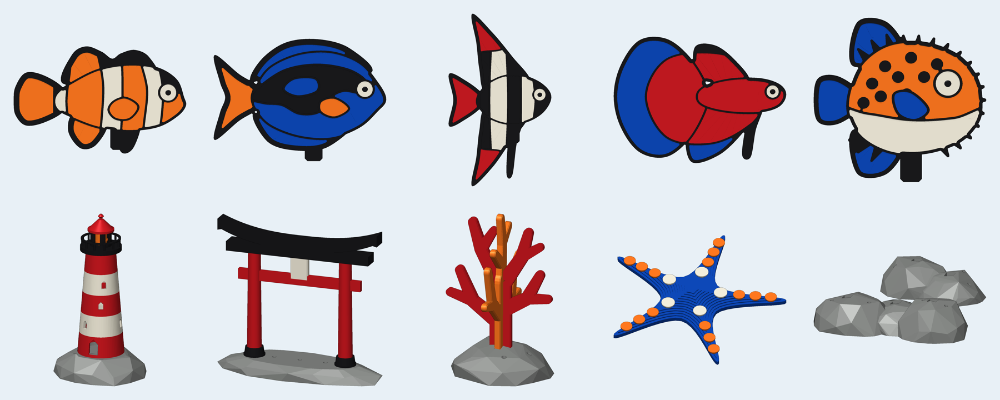

# Snap-Together Aquarium Set

Ten aquarium pieces for a **single-colour printer**. Each part is printed in one colour, and the parts press together into a multicolour model with no glue and no AMS.

Filaments used: **Mandarin Orange · Scarlet Red · Cobalt Blue · Gray · Ivory White · Black**




## The 10 items

| # | Item | Colours | How it goes together |
|---|------|---------|----------------------|
| 1 | Clownfish | orange, white, black | inlay fish (see below) |
| 2 | Cobalt Tang | blue, black, orange, white | inlay fish |
| 3 | Zebra Angelfish | white, black, red | inlay fish |
| 4 | Halfmoon Betta | red, blue, black, white | inlay fish |
| 5 | Spiky Pufferfish | orange, white, blue, black | inlay fish. The spots are windows that show the black core. |
| 6 | Striped Lighthouse | red/white rings, black gallery, orange lamp, red roof, gray rock | rings stack on spigots |
| 7 | Sunken Torii Gate | red pillars + tie beam, black top beam + feet, ivory plaque, gray base | pegs and through-slots |
| 8 | Crossed Staghorn Coral | red plate + orange plate, gray rock | two flat plates cross-lap into an X, then plug into the rock |
| 9 | Blue Starfish | blue body, 15 orange + 5 ivory studs | studs press into holes |
| 10 | Reef Rock Fish Stands | 2 gray rocks, 5 black rods | the fish plug onto rods, and the rods plug into the rocks |

### How the fish work (the "cartoon inlay" trick)
* A **black core** (3.2 mm) is the fish silhouette. Its edge is the black outline.
* **Colour tiles** (2.4 mm) press onto **both sides** of the core with 3 mm pegs. The 1.2 mm gaps between tiles let the core show through as black "ink lines", which gives a stained-glass or cartoon look. Because of these gaps, the tiles never have to fit each other exactly.
* Tiles are printed **face down**, so the visible side is the smooth bed surface. Fin tiles have fin-ray grooves.
* `sideA` tiles are mirror copies of `sideB` tiles. Make one of each.
* One black **eye pin** goes through both eye discs and the core, and forms both pupils.
* The tab under the belly slides into the fork at the top of a rod.

## Files

```
output/plates/<colour>_plateN.3mf   <- load one, print it, swap filament, repeat
output/plates/00_fit_test.3mf       <- print this FIRST
output/stl/<item>/<part>__<colour>.stl   individual parts (colour is in the name)
output/previews/                    renders of every item + each plate layout
```

The plates are laid out for a 256 mm bed (Bambu X1/P1/A1). For smaller beds, import the STLs and let the slicer arrange them.

| Plate | Parts | ≈ filament at 100 % infill |
|---|---|---|
| black_plate1 + black_plate2 | 29 | 140 g |
| red_plate1 | 22 | 66 g |
| orange_plate1 | 37 | 29 g |
| white_plate1 | 34 | 31 g |
| blue_plate1 | 23 | 31 g |
| gray_plate1 | 5 | 220 g |

## Print settings
* 0.4 mm nozzle, 0.2 mm layers. **No supports are needed anywhere.** Every overhang is ≤ 45° or a short bridge.
* **Infill: 100 %.** Plastic is only slightly denser than water. Sealed air in sparse infill can make parts float. The rocks have open, vented hollow bottoms, so they don't trap air even at 100 %. If you want to save gray filament, print the rocks at 20 % and fill their open bottoms with gravel.
* Use a textured or smooth PEI sheet. The fish tiles' show faces print against it.

## Fit test first
`00_fit_test.3mf` makes a black bar with 4 holes (1–4 notches = 0.05 / 0.10 / 0.15 / 0.20 mm clearance) and a white tile with pegs. Find the hole that grips firmly but still lets the peg push in. The default is **0.10** (2 notches). If yours is different, set `CLEAR` in `lib.py` and rebuild.

## Assembly
* **Fish:** push the tiles of one side onto the core, flip it over, and do the other side. Push the eye pin through. Slide the belly tab into a rod fork.
* **Rods → rocks:** square ends go into the square sockets. Suggested pairs: clownfish 65 mm, tang 105 mm, betta 85 mm (large rock); angelfish 125 mm, puffer 45 mm (small rock).
* **Lighthouse:** rock → ring 1 (red, with the door) → white → red → white → red → black gallery → orange lamp on the centre peg → red roof.
* **Torii:** slide a black foot ring over each base peg, then set a pillar on each peg. Thread the red tie beam through both pillar slots. Push the plaque peg into the centre socket of the black top beam, then press the top beam onto the pillar tops.
* **Coral:** lower the orange plate (slot at the bottom) onto the red plate (slot at the top) so they form an X. Then push the X into the cross socket in the rock.
* **Starfish:** press the ivory studs into the 5 inner holes and the orange studs into the rest.

## Aquarium safety
* **PETG** is the best choice for long-term underwater use. PLA works but can soften and get brittle over months in warm water.
* Don't use glue (most CA/epoxy isn't fish-safe). Everything is designed to stay together by friction alone.
* Rinse the parts and soak them for a day before they go in the tank. Hollow parts have vent holes so no air stays trapped.

## Rebuild / customise
```
pip install manifold3d numpy pillow trimesh
python build.py            # STLs, plates, previews  (~1 min)
python build.py --no-render
```
* Fish outlines are spline control points in `designs_fish.py`. The colour regions are "masks" laid over zones, so it's easy to repaint a fish or add a new one.
* The decor is in `decor.py`. Shared geometry helpers and colours are in `lib.py`.
